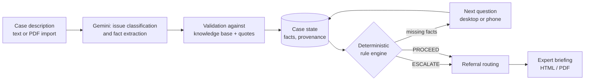

# LexTec Bridge

**An AI-assisted legal intake and handover tool that knows when to ask, when to proceed, and when a human has to take over.**

Hackathon challenge: *LexTec – Teaching AI When to Ask / When Must AI Step Back?*
Scope: seven Swiss residential tenancy-law issues (Canton of Zurich referral routing).

> **Prototype for synthetic data only.** LexTec Bridge supports information gathering and escalation. It does not give legal advice, does not compute legal deadlines, and none of its legal content has been legally approved (see [Limitations](#limitations)). In Gemini mode, case text is sent to Google's API.

## The problem

Social workers meet legal problems (a termination notice, an eviction, mould in a child's room) without being legal specialists. Facts are missing, deadlines are short, and an overconfident AI answer can do real harm. The useful behaviour is not "answer everything" but: collect the right facts, recognise the limits, and hand over to a professional with a clear briefing.

## The solution

1. The social worker describes the situation in free text (or imports a written case description from a PDF).
2. **AI proposes**: it classifies the legal issue(s) and extracts facts. Every extracted fact carries a verbatim quote from the text; output is validated against the knowledge base and untrusted until then.
3. **Rules decide**: a deterministic rule engine (no LLM) returns `ASK`, `PROCEED` or `ESCALATE` with rule IDs and reason codes. Precedence is `ESCALATE > ASK > PROCEED`; unknown stays unknown and is never treated as "no".
4. The system asks the single most important missing question, and after an escalation lets the worker keep collecting information for the expert.
5. It recommends professional contacts (Zurich municipality routing) and creates a versioned **expert briefing** (HTML and PDF).

The social worker stays in control: every extracted fact can be inspected and corrected, and corrections are never overwritten by later AI output.

## Key features

All of the following are implemented in this repository; test evidence is in [`docs/FINAL_SUBMISSION_AUDIT.md`](docs/FINAL_SUBMISSION_AUDIT.md).

* **Seven tenancy issues** from the law team's dossiers: termination by the landlord, payment warning with termination threat, termination for arrears, extension, defects, eviction/clearance, rent increase. Multiple issues can be active in one case.
* **Scope control**: other legal areas (employment, family, immigration …) are reported as *not covered*; mixed cases are split. Synthetic demo issues stay out of the classifier.
* **Deterministic rules** defined in YAML (no code changes for legal content), with a validator and 128 scenario checks.
* **Safety signals** and escalation reasons shown in plain language, with the rule trace one click away.
* **Referral engine v1.2**: roles resolved per municipality (160 Zurich municipalities), cantonal and national fallbacks, verification status shown honestly (150 municipal social services are *not yet individually verified* and are labelled so).
* **Multilingual QR "Sprachbrücke"**: one QR code per case; the client answers the current questions on their phone (de, en, ar, uk; RTL supported); the worker reviews and confirms every answer before it enters the case.
* **PDF import of a written case description** into the editable text field (text only, nothing stored, no document management).
* **Expert briefing** from structured case data, versioned, with provenance of each fact.
* **Fedlex integration**: official federal-law wording is retrieved and cached; wording checks are deterministic (no LLM).
* **Cost and failure control** for Gemini: server-side usage limits, bounded retries, truncated or schema-invalid answers are detected and never "repaired".

## How it works



The LLM never selects the route: it only proposes issues and facts. Rules, questions, referrals and briefings come from the knowledge base and the engine.

## Supported legal scope

| # | Issue | Technical module | Legal content status |
|---|---|---|---|
| 1 | Kündigung durch die Vermieterschaft | `CH_TENANCY_TERMINATION` | DRAFT |
| 2 | Zahlungsaufforderung mit Kündigungsandrohung | `CH_TENANCY_PAYMENT_WARNING` | DRAFT |
| 3 | Kündigung wegen Zahlungsverzug | `CH_TENANCY_PAYMENT_DEFAULT` | DRAFT |
| 4 | Erstreckung des Mietverhältnisses | `CH_TENANCY_EXTENSION` | DRAFT |
| 5 | Mängel an der Mietsache | `CH_TENANCY_DEFECTS` | DRAFT |
| 6 | Ausweisung und Räumung | `CH_TENANCY_EVICTION` | DRAFT |
| 7 | Mietzinserhöhung und einseitige Vertragsänderung | `CH_TENANCY_RENT_INCREASE` | DRAFT |

`DRAFT` means *supported by the software, not legally approved for real clients*. Nothing is marked as verified. Three synthetic demo issues (`employment_termination`, `unpaid_salary`, `tenancy_defects`, status `DEMO_SYNTHETIC`) remain loadable for old data but are never offered to the classifier.

## Technical architecture

* **Frontend** (`apps/web`): React 19, TypeScript (strict), Vite, Tailwind CSS 4, TanStack Query, React Router, Motion; tests with Vitest and Playwright.
* **Backend** (`apps/api`): Python ≥ 3.12, FastAPI, Pydantic v2, SQLAlchemy 2 with Alembic migrations, SQLite, PyYAML (safe loading), Jinja2 and Chromium (via Playwright) for the PDF briefing, `pypdf` for the case-description import.
* **AI**: Google Gemini through the official `google-genai` SDK (default model `gemini-3.8-flash`, configurable) or a deterministic mock provider for development and all automated tests.
* **Knowledge base** (`knowledge_base/`): YAML for issues, facts, questions, rules, escalation, sources, safety signals, referrals and briefing profiles.

```
apps/api/            FastAPI app, services (ai, knowledge, decisions, cases, bridge, referrals, report), tests
apps/web/            React app (features/*), Vitest unit tests, Playwright e2e tests
knowledge_base/      Law-team content as YAML (legal_issues, referrals, sources, policies, tests)
scripts/             dev.ps1 / dev.sh (launcher), check.ps1 (all checks), kb/ (generators)
docs/                Architecture, API, knowledge-base guide, status, final audit, law-team inputs
demo_fixtures/       Synthetic demo cases
```

## Getting started (Windows)

Prerequisites: Python 3.12+, Node.js 22+ (Vite needs ≥ 20.19), optionally [`uv`](https://docs.astral.sh/uv/).

```powershell
git clone https://github.com/nevi000/Lextec.git
cd Lextec
.\scripts\dev.ps1 -Seed -ApiPort 8001 -WebPort 5174
```

The script creates `.env` from `.env.example`, creates the virtual environment, installs dependencies, applies the database migrations, seeds three synthetic demo cases (mock AI) and starts both servers. Without arguments it uses ports 8000 and 5173.

| | URL (example above) |
|---|---|
| Web app | http://localhost:5174 |
| API | http://localhost:8001 |
| API docs | http://localhost:8001/docs |

macOS/Linux: `./scripts/dev.sh --seed` (`API_PORT` / `WEB_PORT` environment variables).

### Using real Gemini

In `.env` set `AI_PROVIDER=gemini` and `GEMINI_API_KEY=<your key>`, then restart. The sidebar then states that texts are sent to an external AI. The application never falls back silently to the mock. **Never commit `.env`.**

For a demo, raise the default usage limits (30 requests per day): set `AI_DAILY_REQUEST_LIMIT`, `AI_DAILY_TOKEN_LIMIT`, `AI_DAILY_BUDGET_USD` in `.env`. These are application limits, not a Google billing cap.

### Phone on the same network (Sprachbrücke)

```powershell
.\scripts\dev.ps1 -Lan -ApiPort 8001 -WebPort 5174
```

The web server then listens on the network; the API stays on `127.0.0.1`. Requests from other devices may only use the phone endpoints (`/api/bridge/*`), everything else answers `403`. The launcher picks the adapter that owns the default route, prints it, checks reachability and shows a narrow firewall rule if needed (it never changes firewall settings itself). **Restart the launcher after switching networks**, because the address is chosen at start. The connection is plain HTTP: use synthetic data only. Without a phone, open the shown link in a second browser window.

## Environment variables

Defined in `.env.example` (all optional except the key for Gemini mode): `AI_PROVIDER` (`mock` | `gemini`), `GEMINI_API_KEY`, `GEMINI_MODEL`, `AI_THINKING_LEVEL`, usage limits (`AI_MAX_CALLS_PER_CASE`, `AI_MAX_INPUT_TOKENS_PER_CALL`, `AI_MAX_OUTPUT_TOKENS_PER_CALL`, `AI_DAILY_REQUEST_LIMIT`, `AI_DAILY_TOKEN_LIMIT`, `AI_DAILY_BUDGET_USD`, `AI_CASE_BUDGET_USD`), `AI_REPHRASE_QUESTIONS`, `APP_TODAY`, `APP_ENV`, `DATABASE_URL`, Sprachbrücke (`BRIDGE_TTL_MINUTES`, `BRIDGE_PUBLIC_BASE_URL`, `RESTRICT_REMOTE_ACCESS`), Fedlex (`FEDLEX_*`). `.env.example` contains no secrets.

## Running tests

```powershell
.\scripts\check.ps1          # ruff, knowledge-base validation, pytest, typecheck, vitest, production build
.\scripts\check.ps1 -E2E     # additionally the Playwright browser tests
```

Individually: `cd apps\api; .venv\Scripts\python.exe -m pytest` · `cd apps\web; npm run typecheck; npm test; npm run build; npm run e2e` (the e2e run uses ports 8100/5273 and a throw-away database; do not run two e2e runs at the same time). A full backend run takes several minutes. No automated test calls the real Gemini API. While developing, run only the affected test files (`pytest tests\test_x.py -q -x --tb=short`).

## Demo scenarios (all synthetic)

Start with `-Seed`; the three seeded cases are an employment-law case (AI steps back), a mixed case and a defects case.

* **A – Targeted questions.** *"Mein Vermieter hat der Klientin die Wohnung gekündigt, ohne amtliches Formular, in Zürich."* → issue 1 recognised, one question at a time; the missing official form leads to a professional-review recommendation with Zurich referrals.
* **B – Human escalation.** *"Im Kinderzimmer wächst grossflächig Schimmel. Das vierjährige Kind hustet seit Wochen nachts. Der Vermieter hat nicht reagiert."* → defects issue, `ESCALATE` (health report); further questions can still be answered, then create the expert briefing. No medical conclusion is drawn.
* **C – Multilingual intake.** In phase 2 click *Sprachbrücke aktivieren*, scan the QR code, choose a language, answer on the phone, confirm on the desktop; the next question follows automatically. Real translations need Gemini mode (the mock only marks texts, e.g. `[EN · Mock]`).
* **Where AI steps back.** *"Meine Klientin hat ihren Job verloren und keinen Lohn erhalten. Deshalb … Zahlungsaufforderung mit Kündigungsandrohung erhalten."* → the tenancy part is processed; employment law is reported as *not covered*; the case escalates for the unsupported area.

## Safety and responsible AI

* AI and rules are separated: the model proposes, the knowledge base and deterministic engine decide. Instructions inside a case text or imported PDF are data and cannot change the outcome (covered by tests).
* Unknown is not No; ambiguous and contradictory facts are kept visible.
* Verbatim evidence for each extracted fact is checked against the stored message; invalid enum values, unknown IDs and truncated model answers are rejected, not guessed.
* "Handover" is a recorded state. The system never claims that a professional has accepted a case and sends nothing to anyone automatically.
* Legal sources are shown as unverified unless the Fedlex comparison says otherwise; no legal deadline is computed or asserted.
* Gemini is an external provider; text leaves the machine in Gemini mode. The prototype is for synthetic data only.

## Limitations

* Hackathon prototype, local single-process deployment (SQLite). No authentication, roles, audit log or retention policy.
* Swiss tenancy law only; all seven issues are `DRAFT` and not legally approved. Open legal review points: [`docs/ISSUE_COVERAGE_MATRIX.md`](docs/ISSUE_COVERAGE_MATRIX.md) and [`docs/KNOWLEDGE_BASE.md`](docs/KNOWLEDGE_BASE.md#12-offene-entscheide-für-das-law-team).
* Referral data covers the municipality structure of Zurich; 150 municipal social services are not yet individually verified (shown as such). Other cantons fall back to cantonal or national bodies.
* Machine translation is not a replacement for qualified interpreting on legally important points. The Sprachbrücke runs over plain local HTTP.
* The mock AI is keyword-based and only demonstrates the pipeline. Gemini output quality has only been exercised with a few live calls.
* Production use would additionally need: authentication and access control, encryption at rest, a data-protection assessment (revDSG), a lawful basis and contract for the external AI provider, hosting and retention decisions, and legal review of all content.

## Team

| Name | Role |
|---|---|
| Noa Franchetto, Orell P. Jenning, Sofia Zaltron | Law team (legal content, dossiers) |
| Nevio Gübeli | Product and software development |

## AI-Assisted Development

Parts of the code were developed with assistance from Claude Code. The team reviewed and tested the implementation.

## Documentation

[Architecture](docs/ARCHITECTURE.md) · [API](docs/API.md) · [Knowledge base guide](docs/KNOWLEDGE_BASE.md) · [Implementation status](docs/IMPLEMENTATION_STATUS.md) · [Final audit](docs/FINAL_SUBMISSION_AUDIT.md) · [Issue coverage matrix](docs/ISSUE_COVERAGE_MATRIX.md)
